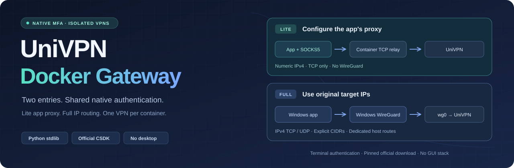
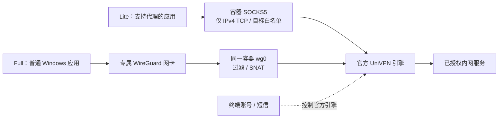

<p align="center">
  
</p>
<p align="center">
  <a href="https://hub.docker.com/r/javazero/univpn-docker-gateway"></a>
  <a href="https://github.com/JavaZeroo/univpn-docker-gateway/actions/workflows/test.yml"></a>
  <a href="LICENSE"></a>
</p>
<p align="center"><strong>多个 UniVPN 共存，终端输入短信。应用代理，或直接访问内网 IP。</strong></p>
<p align="center">
  <a href="docs/lite.md">Lite 使用</a> · <a href="docs/quickstart.md">Full 快速开始</a> · <a href="docs/agent-setup.md">Agent 部署</a> · <a href="docs/architecture.md">Full 架构</a> ·
  <a href="docs/simplification.md">简化设计</a> · <a href="docs/subnet-gateway-validation.md">实测记录</a>
</p>

## 先选版本

| | Lite：只运行 Docker | Full：按原始 IP 访问 |
| --- | --- | --- |
| 应用怎样连接 | 配置 `127.0.0.1:1080` SOCKS5 | 直接填写内网 IP 和端口 |
| Windows 侧 | 不安装 WireGuard，不改网卡 | 启动器准备官方 WireGuard 和独立网卡 |
| 转发范围 | IPv4 TCP；应用需支持 SOCKS5 | 指定 IPv4 网段，支持 TCP / UDP |
| 镜像标签 | `lite` / `0.4.0-lite` | `full` / `0.4.0-full` |

`latest` 和 `0.4.0` 仍指向 Full。两版共用终端认证控制器，无桌面或 VNC；都需要先启动 [Docker Desktop](https://docs.docker.com/desktop/setup/install/windows-install/) 的 Linux 容器环境，当前厂商引擎为 **10781.21.0.0831 / Linux amd64**。

## Lite：一条命令

在 Windows PowerShell 运行：

```powershell
docker run --rm -it --log-driver none --name univpn-lite `
  --cap-add NET_ADMIN --device /dev/net/tun `
  -p 127.0.0.1:1080:1080 `
  -v univpn-lite-config:/config `
  -v univpn-vendor-cache:/var/cache/univpn `
  javazero/univpn-docker-gateway:lite
```

首次按提示填写网关 `host:port`、目标 CIDR 和 SSH 探针，再输入 VPN 账号密码与本次短信。连接后保持终端运行，`Ctrl+C` 停止；网络配置和厂商缓存保留在 Docker 卷中，凭据不保存。

应用需单独设置 SOCKS5。例如访问数字 IPv4 的 HTTP 服务：

```powershell
curl.exe --proxy socks5h://127.0.0.1:1080 http://10.80.0.11:8080/
```

Lite 仅支持 SOCKS5 CONNECT 的 **IPv4 TCP**，不解析目标域名、不支持 UDP / IPv6；裸 `ssh` 不会自动使用它。[代理设置与边界](docs/lite.md)

## Full：两条命令

在一个空文件夹的 Windows PowerShell 中运行：

```powershell
docker run --rm -v "${PWD}:/output" javazero/univpn-docker-gateway:full export-client
.\univpn\univpn.cmd
```

启动器按需准备 Windows WireGuard、生成配置并连接；首次安装与创建专属 `univpn-*` 隧道可能分别需要系统授权。连接后，WindTerm、浏览器等直接填写原始 IP，例如 `ssh your-user@10.80.0.11`。[首次使用和日常命令](docs/quickstart.md)

## 交给你的 Agent

把下面这段发给能执行本机终端命令的 Agent，按需补充网关和目标即可：

```text
请按 https://raw.githubusercontent.com/JavaZeroo/univpn-docker-gateway/main/docs/agent-setup.md 在本机部署 UniVPN Docker Gateway。
先确认我需要 Lite 应用代理还是 Full 原始 IP 接入，再完成环境检查、配置和真实连通验证。
缺少网关、目标 CIDR 或 SSH 探针时先问我。
保留现有 VPN 和密钥；账号、密码、短信及系统授权由我在终端或系统弹窗中完成。
```

## 流量怎样走



Lite 使用 Python 标准库提供代理，不包含 `wireguard-tools` 或 Windows 脚本。Full 的 `wg0` 与 UniVPN 位于同一容器，不需要 WireGuard 辅助容器。厂商文件首次从官方获取并校验缓存，公开镜像不含厂商二进制。

## 验证与边界

- **Full 已有真实链路：** Windows 默认选路下 4/4 SSH、双向各 1 MiB HTTP、三种大小 UDP，以及探针失败阻断与恢复。[证据](docs/subnet-gateway-validation.md)
- **Lite 新入口：** 隔离模拟网络已通过 SSH、1 MiB HTTP、真实网卡绑定及故障阻断/恢复；官方引擎 idle 启动通过。完整真实 VPN 代理接入仍待验收。[范围](docs/image-release.md)
- 两版仅放行配置的目标 CIDR，真实就绪后开放入口。Lite 出站 socket 绑定 VPN 接口，失败不回落到 `eth0`。
- 当前仅 IPv4，不提供内网 DNS 或重叠目的地映射；Full 目标路由重叠会影响 Windows 选路。重启恢复仍需进一步验收。
- 单容器资源与 Docker Desktop/WSL2 的整机开销分开计算；镜像免构建不代表平台没有内存成本。

项目自写代码采用 [GPL-3.0-only](LICENSE)，厂商程序遵循其自身许可。项目受 [jesusdf/huawei-vpn](https://github.com/jesusdf/huawei-vpn) 启发。[贡献](CONTRIBUTING.md) · [镜像与本地构建](docs/image-release.md)
