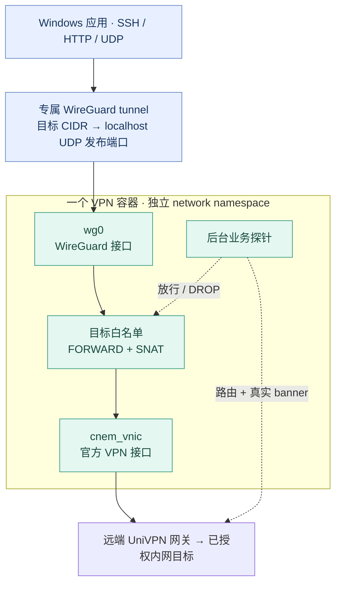
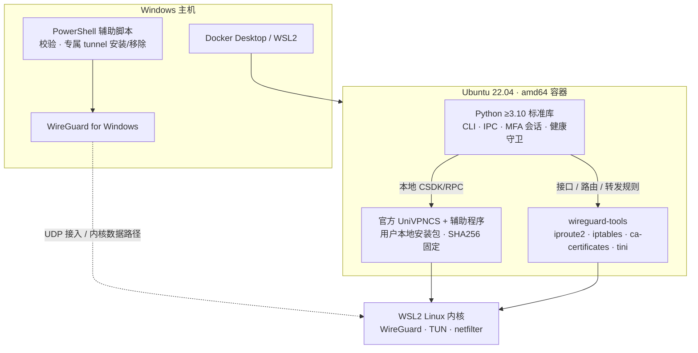

<p align="center">
  
</p>

<p align="center">
  <a href="https://github.com/JavaZeroo/univpn-docker-gateway/actions/workflows/test.yml"></a>
  <a href="LICENSE"></a>
  <a href="docs/quickstart.md"></a>
  <a href="docs/native-rpc-research.md"></a>
</p>

<p align="center">
  <strong>一套 VPN，一个容器。终端完成短信认证，Windows 直接访问目标内网 IP。</strong><br />
  <sub>Native MFA · Isolated routes · Direct subnet access</sub>
</p>

<p align="center">
  <a href="docs/quickstart.md">快速开始</a> ·
  <a href="#架构">架构</a> ·
  <a href="#日常命令">命令速查</a> ·
  <a href="#验证矩阵">实测证据</a> ·
  <a href="docs/architecture.md">依赖与设计</a> ·
  <a href="#边界与安全策略">边界</a>
</p>

---

## 让多个 UniVPN 共存

Windows UniVPN 通常一次维护一套连接。本项目把另一套连接放进独立 Docker 网络命名空间，通过 WireGuard 给 Windows 提供按目标 CIDR 的入口。SSH、HTTP、UDP 使用服务器原始 IP，无需逐个发布 SSH 端口。

| 能力 | 实现 |
| --- | --- |
| **纯终端短信认证** | Python 前端通过本地 CSDK/RPC 驱动官方 UniVPNCS，验证码续交到同一引擎会话 |
| **按 IP 访问内网** | Windows 专属 WireGuard tunnel → localhost UDP → 容器 `wg0` → UniVPN |
| **每套连接独立** | 每个 VPN 容器拥有自己的网卡、路由、认证状态及 WireGuard peer |
| **按业务健康放行** | 认证、隧道启动、真实目标探针分别判断；探针失败后守卫关闭专属转发链 |
| **保留现有环境** | Windows 辅助脚本只管理独立命名的 `univpn-*` tunnel，不批量停止其他 VPN |

**已实测：** Windows 默认选路下，未绑定接口或源地址的普通 socket 经 Docker/真实 UniVPN 完成 **4/4 SSH banner、双向各 1 MiB HTTP、32/1200/4096 字节 UDP**，以及探针故障后的阻断和恢复。测试使用四个精确 `/32`，没有接管整个公网地址段。[查看完整证据](docs/subnet-gateway-validation.md)

> 这是有实测证据的实验项目，尚未承诺任意网关、客户端版本或架构兼容。当前固定 **10781.21.0.0831 / Linux amd64**；厂商客户端由用户自行取得并在本地构建，仓库不分发其二进制。

## 架构

WireGuard 只负责 **Windows 到 Docker** 的入口。连接远端 VPN、认证及建立 `cnem_vnic` 仍由官方 UniVPN 引擎完成；`wg0` 与它位于**同一个容器网络命名空间**，没有额外的 WireGuard 服务容器。



### 分层依赖

默认后端使用 Python 标准库，无 Qt、X11、Xvfb、DBus、AT-SPI、VNC/noVNC 依赖。Docker Desktop/WSL2 的平台成本仍然存在；容器内存不能代替整机占用。



容器使用 `NET_ADMIN` 和 `/dev/net/tun`，不启用 `privileged` 或 host 网络。代码、厂商程序与内核能力的关系，以及简化方向，见[架构与设计](docs/architecture.md)。

## 快速上手

需要 Windows 上的 Docker Desktop Linux 容器、WireGuard，以及适配当前固定版本的官方 Linux 安装程序。Windows tunnel 安装和 metric 设置需要一次管理员授权；VPN 登录在普通终端完成。

完整的文件准备、密钥生成和逐步验证见 **[快速开始](docs/quickstart.md)**。先准备：

- `vendor/univpn.run` 和本地 `.env` 中的 `UNIVPN_SHA256`。
- `private/vpn.json`：网关、明确目标 CIDR、Windows 接入 `/32`、真实 banner 探针。
- 网段接入使用的两端 WireGuard 配置；容器端为 `private/wg0.conf`，Windows 端文件名为 `univpn-*.conf`。私钥留在本地。

### 1. 构建并登录

```powershell
docker compose build
docker compose up -d
docker compose exec vpn vpnctl login
docker compose exec vpn vpnctl status
```

`login` 在同一 TTY 输入账号、密码及最新短信验证码，不要加 `-T`。**只有 `data_plane_ready: true`，`status` 才以状态码 0 退出。** 例如可使用 `10.80.0.11:22` 的 `SSH-2.0-` banner 检查真实数据面；该探针不限制转发协议为 SSH。

### 2. 预检 Windows 入口

```powershell
powershell.exe -NoProfile -ExecutionPolicy Bypass -File scripts/windows-gateway.ps1 `
  -TunnelConfig private/univpn-lab.conf -GatewayConfig private/vpn.json `
  -Endpoint 127.0.0.1:51829
```

默认 **Plan 只读**：严格比对客户端地址和目标 CIDR，检查 endpoint、MTU、WireGuard 签名、已有服务/网卡及当前最佳路由。审查通过后，在同一命令增加 `-Mode Install -Elevate` 安装专属 tunnel；用户确认 UAC 后才执行。脚本仅给新建接口设置 IPv4 **ActiveStore metric 0**，然后复核目标选路，不调整其他 VPN。

`ExecutionPolicy Bypass` 仅影响这次 PowerShell 进程，不修改持久策略。安装成功还需用真实 IP 复核业务、WG 收发及容器出口；具体步骤见[快速开始](docs/quickstart.md)。

## 日常命令

| 目的 | 命令 | 行为 |
| --- | --- | --- |
| 登录 | `docker compose exec vpn vpnctl login` | 一次显式认证，在同一终端续交短信 |
| 稍后输入验证码 | `docker compose exec vpn vpnctl login --no-otp` | 收到挑战后返回；用 `vpnctl sms` 续交 |
| 提交现有验证码 | `docker compose exec vpn vpnctl sms` | 不重新登录，不重发短信 |
| 查看状态 | `docker compose exec vpn vpnctl status` | 网络就绪才返回 0；认证成功不等于可转发 |
| 取消待完成认证 | `docker compose exec vpn vpnctl cancel` | 本地会话作废 |
| 停止此实例 | `docker compose stop vpn` | 停止容器及其 VPN |
| 新开一次认证会话 | `docker compose restart vpn`，再 `docker compose exec vpn vpnctl login` | 旧认证上下文不会复用，需要人工认证 |
| 移除 Windows 入口 | Windows 脚本 `-Mode Uninstall -TunnelConfig … -Elevate` | 仅移除对应 `univpn-*` 服务及其接口/路由 |

短信挑战最多约 180 秒，每次只允许一次提交。失败、过期或取消后，重启容器再显式登录；项目不会自动重复发送密码或短信。需要验证码的断线重认证仍由用户完成。

## 多实例隔离

每个实例使用独立的 Compose project 与配置目录。不要让不同 VPN 实例共享 network namespace，也不要添加 `--network=host`。

| 需要独立的项目 | 示例 |
| --- | --- |
| Compose project / 配置目录 | `vpn-a` + `private/a/`；`vpn-b` + `private/b/` |
| 发布 UDP 端口 | `WG_PORT=51829` / `51830`，均只绑定 localhost |
| WireGuard 接入地址与密钥 | 不冲突的接入子网；每个实例单独生成密钥 |
| 允许的业务 CIDR | 只写实际需要的目的地址；Windows peer 与 `vpn.json` 严格一致 |

Compose 通过 `VPN_CONFIG_DIR` 选择配置目录、`WG_PORT` 选择端口。**重叠的业务目标尚不支持同时区分**；容器内路由隔离不会替 Windows 解决同目的 IP 的冲突。首版只处理 IPv4 和直接 IP，不提供内网条件 DNS。

## 验证矩阵

以下为 **2026-10-29 本轮验证快照**。单元测试、模拟网络与真实环境分别记录，不互相替代。

| 层级 | 已验证 | 证据 / 限制 |
| --- | --- | --- |
| Python 控制与会话 | **120 项测试** | 分帧、EOF/超时、单次 SMS、证书策略、健康缓存、规则与控制接口；使用模拟对象 |
| Windows 辅助脚本 | **21 项模拟检查** | PS5.1 / PS7；不在测试中触发 UAC、安装服务或修改网络 |
| GitHub Actions | **5 个 job 通过** | unit / network / wireguard / windows-plan / accessibility；[运行状态](https://github.com/JavaZeroo/univpn-docker-gateway/actions/workflows/test.yml) |
| 独立 Linux 网络 | TCP / HTTP / UDP、SNAT、白名单与出口回落阻断 | veth 模拟 VPN；另有真实 kernel WireGuard 测试 |
| 官方原生认证 | 真实短信、`AUTH_OK`、隧道启动 | 固定厂商版本，无 GUI；[认证研究](docs/native-rpc-research.md) |
| Linux → 真实 UniVPN | 4 SSH、双向 1 MiB HTTP、UDP、探针失败阻断/恢复 | WireGuard endpoint 直连 Docker bridge |
| Windows → 真实 UniVPN | **默认选路的普通 socket**：4 SSH、双向 1 MiB HTTP、UDP 32/1200/4096 字节 | localhost UDP 路径、WG/转发计数和远端 SNAT 来源交叉核对 |
| Windows 健康门控 | 探针失败时 SSH/HTTP/UDP 阻断，移除故障后恢复 | 未实际断开厂商认证会话；[网段网关实测](docs/subnet-gateway-validation.md) |

状态查询的缓存修复已有源码与单元测试证据；重建容器后再次真实认证的回归尚待进行。早期 **18.8 MiB** 仅为连接后单次容器样本，不是稳定、峰值或整机内存承诺，也不包含 Docker Desktop/WSL。

```powershell
python -m unittest discover -s tests -v
powershell.exe -NoProfile -ExecutionPolicy Bypass -File tests/windows_gateway_test.ps1
```

网络集成测试需要专用一次性环境及相应内核/namespace 权限，不能在正在认证的正式 VPN namespace 中执行。历史 GUI 控件测试是独立研究路径，不代表默认镜像依赖图形栈。

## 边界与安全策略

- **兼容范围：** 目前只验证官方 Linux amd64 `10781.21.0.0831`。ARM、其他厂商版本及任意网关策略没有兼容承诺。
- **证书：** 默认使用 CA 链和主机名验证。可选 `approved_certificate_sha256` 必须是明确批准的叶证书摘要，仅为精确网关/端口的本次登录接受例外。独立 TLS 预检**不等于引擎侧连接 pinning**；不匹配直接失败，不修改系统信任库。
- **故障范围：** 已验证探针故障门控和隔离测试中的普通出口回落阻断；真实 VPN 断线/重新认证、Docker Desktop/容器重启、Windows 服务停用回退尚未完整验收。
- **路由生命周期：** ActiveStore metric 不保证跨服务重建保留。停用新 Windows tunnel 后，旧 VPN 可能恢复接管目标，这是客户端回退，与 tunnel 保持激活时的容器阻断是两种情况。
- **配置与资源：** `private/`、`vendor/`、`.env` 不进入 Git；不要把密码、OTP 或私钥放入 argv、公开配置或日志。Docker/WSL 平台成本与单个容器开销应分别测量。

更多实现细节见[架构与简化设计](docs/architecture.md)，操作与排查见[快速开始](docs/quickstart.md)。

## 下一步怎样更简单

- **本轮已整理：** 首次启动前备齐配置，只构建一次并自动加载 wg0；默认地址的初始化片段由 `vpn.json` 生成 Windows 目标列表。
- **下一优先级：** 将这些片段封装为单一 profile 初始化命令，统一生成双端配置与密钥，复用现有安装和路由校验器。
- **继续保留：** Windows 的三层入口、容器隔离、真实探针与用户 MFA。移除 WireGuard 不能只靠添加一条指向 Docker bridge 的 Windows 路由。

方案比较与尚未实现的部分见[简化分析](docs/simplification.md)。参与验证或适配新版本前，请读[贡献指南](CONTRIBUTING.md)。

## 来源与许可

本项目受 [jesusdf/huawei-vpn](https://github.com/jesusdf/huawei-vpn) 的容器封装方式启发。**本仓库自行编写的源码采用 [GPL-3.0-only](LICENSE)**；官方 UniVPN 客户端不属于本项目开源代码，使用和再分发受其自身许可约束。

项目不发布含厂商程序的安装包或镜像。用户从[厂商页面](https://www.leagsoft.com/doc/article/103107.html)自行取得安装程序，在本地校验并构建。
