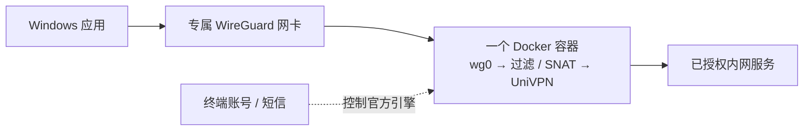

<p align="center">
  
</p>
<p align="center">
  <a href="https://hub.docker.com/r/javazero/univpn-docker-gateway"></a>
  <a href="https://github.com/JavaZeroo/univpn-docker-gateway/actions/workflows/test.yml"></a>
  <a href="LICENSE"></a>
</p>
<p align="center"><strong>多个 UniVPN 共存，终端输入短信，Windows 直接访问内网 IP。</strong></p>
<p align="center">
  <a href="docs/agent-setup.md">Agent 部署</a> · <a href="docs/quickstart.md">快速开始</a> · <a href="docs/architecture.md">架构与依赖</a> ·
  <a href="docs/simplification.md">简化设计</a> · <a href="docs/subnet-gateway-validation.md">实测记录</a>
</p>

## 交给你的 Agent

把下面这段发给能执行本机终端命令的 Agent，按需补充网关和目标即可：

```text
请按 https://raw.githubusercontent.com/JavaZeroo/univpn-docker-gateway/main/docs/agent-setup.md 在本机部署 UniVPN Docker Gateway。
自动完成环境检查、配置生成、连接和真实连通验证；缺少网关、目标 CIDR 或 SSH 探针时先问我。
保留现有 VPN 和密钥；账号、密码、短信及系统授权由我在终端或系统弹窗中完成。
```

[Agent 操作说明](docs/agent-setup.md)包含无需交互提问的配置入口、会话续接和验收标准。也可以自己执行下面两步。

## Windows 首次使用

先安装并启动 **[Docker Desktop](https://docs.docker.com/desktop/setup/install/windows-install/)（Windows x64，Linux 容器 / WSL2）**。WireGuard 由启动器按需安装，不用提前手动安装。

在 Windows 新建一个空文件夹（例如桌面的 `vpn-demo`），在该文件夹中打开 **PowerShell**，依次运行：

```powershell
docker run --rm -v "${PWD}:/output" javazero/univpn-docker-gateway:latest export-client
.\univpn\univpn.cmd
```

第一条将 Windows 启动器导出到这个文件夹的 `univpn` 子目录。`univpn.cmd` 是启动脚本；第二条在**同一个 Windows PowerShell 窗口、同一个文件夹**执行它，`.\` 表示当前目录。

启动器准备 WireGuard、生成配对配置并连接。按提示输入网关（如 `vpn.example.com:443`）、目标 CIDR 和 SSH 探针，再输入 VPN 账号密码及需要的短信。首次安装 WireGuard 和创建专属隧道可能分别要求管理员授权。

连接后，WindTerm、浏览器等应用直接填写原始内网 IP 和端口，例如 `ssh your-user@10.80.0.11`。无需 Git、Python、本机构建或手填密钥。[完整首次使用说明](docs/quickstart.md)

## WireGuard 装在哪里

- **Windows 宿主机：** 使用官方 WireGuard，标准目录为 `C:\Program Files\WireGuard`，为应用提供网络入口。已有签名有效的安装会直接复用，不运行安装器或升级已有客户端；本项目只创建独立的 `univpn-*` 隧道。
- **Docker 容器：** 运行 UniVPN、`wg0` 接口和转发规则，没有 Windows 客户端或桌面。官方 UniVPN 组件首次自动获取并校验缓存，当前固定 **10781.21.0.0831 / Linux amd64**。

原有 WireGuard 隧道保持运行。**目标 CIDR 重叠时仍会参与 Windows 选路竞争**，需核对实际路径；不能将独立隧道理解成所有流量都互不影响。

## 流量怎样走



用户只需预装 Docker Desktop；Windows 启动器准备 WireGuard，镜像预装 Ubuntu 22.04、Python 标准库和网络工具。每套 VPN 独立网络命名空间，无桌面、VNC 或 WireGuard 辅助容器。[完整依赖图与认证时序](docs/architecture.md)

## 能否只启动容器

容器内的程序可以使用容器 VPN；Windows 应用按原始 IP 直连还需要宿主机网卡与路由，因此当前保留一个 Windows 启动器。HTTP/SOCKS 代理可省去 VPN 网卡，但需逐应用设置，能力范围也不同；当前镜像尚未提供该模式。[接入方案比较](docs/simplification.md)

## 验证与边界

- 原有真实链路已验证：Windows 默认选路下 **4/4 SSH、双向各 1 MiB HTTP、三种大小 UDP**，以及探针失败阻断与恢复。[证据](docs/subnet-gateway-validation.md)
- 新启动器的配置、生命周期与公开镜像另有测试；不将模拟检查当作新用户真实短信和 Windows 安装验收。
- 当前是 **IPv4 实验项目**：明确目标 CIDR，拒绝默认路由；不解决重叠目的地和内网 DNS。重启恢复仍需进一步验收。
- 单容器资源与 Docker Desktop/WSL2 的整机开销分开计算；镜像免构建不代表平台没有内存成本。

项目自写代码采用 [GPL-3.0-only](LICENSE)，厂商程序遵循其自身许可。项目受 [jesusdf/huawei-vpn](https://github.com/jesusdf/huawei-vpn) 启发。[贡献](CONTRIBUTING.md) · [镜像与本地构建](docs/image-release.md)
