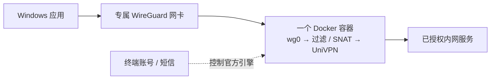

<p align="center">
  
</p>
<p align="center">
  <a href="https://hub.docker.com/r/javazero/univpn-docker-gateway"></a>
  <a href="https://github.com/JavaZeroo/univpn-docker-gateway/actions/workflows/test.yml"></a>
  <a href="LICENSE"></a>
</p>
<p align="center"><strong>多个 UniVPN 共存，终端输入短信，Windows 直接访问内网 IP。</strong></p>
<p align="center">
  <a href="docs/agent-setup.md">Agent 部署</a> · <a href="docs/quickstart.md">快速开始</a> · <a href="docs/architecture.md">架构与依赖</a> ·
  <a href="docs/simplification.md">简化设计</a> · <a href="docs/subnet-gateway-validation.md">实测记录</a>
</p>

## 交给你的 Agent

把下面这段发给能执行本机终端命令的 Agent，按需补充网关和目标即可：

```text
请按 https://raw.githubusercontent.com/JavaZeroo/univpn-docker-gateway/main/docs/agent-setup.md 在本机部署 UniVPN Docker Gateway。
自动完成环境检查、配置生成、连接和真实连通验证；缺少网关、目标 CIDR 或 SSH 探针时先问我。
保留现有 VPN 和密钥；账号、密码、短信及系统授权由我在终端或系统弹窗中完成。
```

[Agent 操作说明](docs/agent-setup.md)包含无需交互提问的配置入口、会话续接和验收标准。也可以自己执行下面两步。

## 两步连接

先安装 **Docker Desktop（Linux 容器 / WSL2）** 和 [WireGuard for Windows](https://www.wireguard.com/install/)，启动 Docker Desktop。在要保存配置的目录打开 PowerShell：

```powershell
docker run --rm -v "${PWD}:/output" javazero/univpn-docker-gateway:latest export-client
.\univpn\univpn.cmd
```

按提示填写网关（支持 `vpn.example.com:443`）、目标 CIDR 和 SSH 探针，然后输入账号、密码及需要的短信验证码。首次创建 Windows 专属网卡时确认一次 UAC。连接成功后直接使用 `ssh your-user@10.80.0.11`、浏览器或其他应用。

**无需 Git、Python、本机构建、手填密钥或逐个映射 SSH 端口。** 镜像包含运行环境、配置生成器和 Windows 启动器；厂商组件首次从官方自动下载约 30 MB，逐层校验摘要后缓存，不随公开镜像分发。当前固定 Linux amd64 / **10781.21.0.0831**。

已有 `univpn` 目录时直接运行第二条命令，保留密钥与当前认证会话；导出不会覆盖旧目录。自签证书需要独立核验后配置，[详见快速开始](docs/quickstart.md)。

## 日常使用

```powershell
.\univpn\univpn.cmd -Mode Status
.\univpn\univpn.cmd -Mode Stop
.\univpn\univpn.cmd
```

`Stop` 停止本实例的 VPN 容器，保留专属网卡、配置与下载缓存；最后一条重新连接。彻底移除该网卡用 `-Mode Remove`。第二套 VPN 使用不同的名称、UDP 端口和接入网段，见[多实例示例](docs/quickstart.md#再加一套-vpn)。

## 流量怎样走



宿主机依赖 Docker Desktop/WSL2 与 WireGuard；镜像预装 Ubuntu 22.04、Python 标准库和网络工具。每套 VPN 独立网络命名空间，无桌面、VNC 或 WireGuard 辅助容器。[完整依赖图与认证时序](docs/architecture.md)

## 验证与边界

- 原有真实链路已验证：Windows 默认选路下 **4/4 SSH、双向各 1 MiB HTTP、三种大小 UDP**，以及探针失败阻断与恢复。[证据](docs/subnet-gateway-validation.md)
- 新启动器的配置、生命周期与公开镜像另有测试；不将模拟检查当作新用户真实短信和 Windows 安装验收。
- 当前是 **IPv4 实验项目**：明确目标 CIDR，拒绝默认路由；不解决重叠目的地和内网 DNS。重启恢复仍需进一步验收。
- 单容器资源与 Docker Desktop/WSL2 的整机开销分开计算；镜像免构建不代表平台没有内存成本。

项目自写代码采用 [GPL-3.0-only](LICENSE)，厂商程序遵循其自身许可。项目受 [jesusdf/huawei-vpn](https://github.com/jesusdf/huawei-vpn) 启发。[贡献](CONTRIBUTING.md) · [镜像与本地构建](docs/image-release.md)
