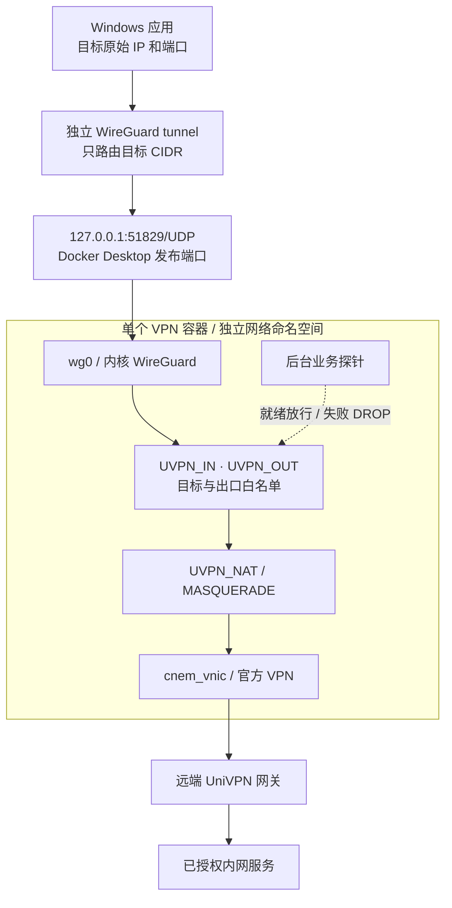
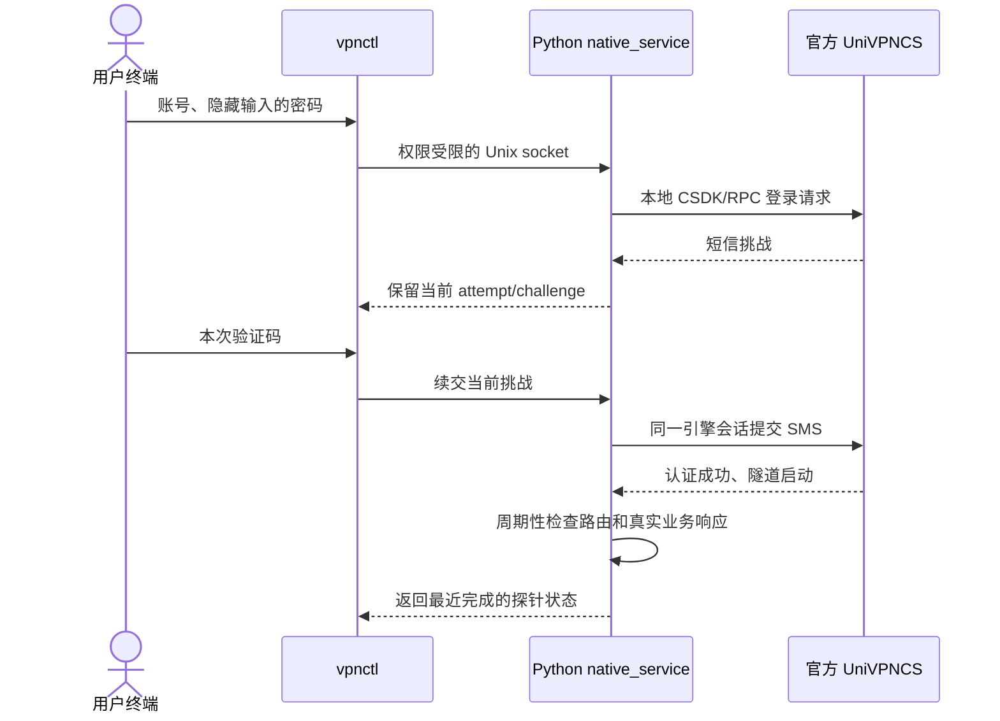
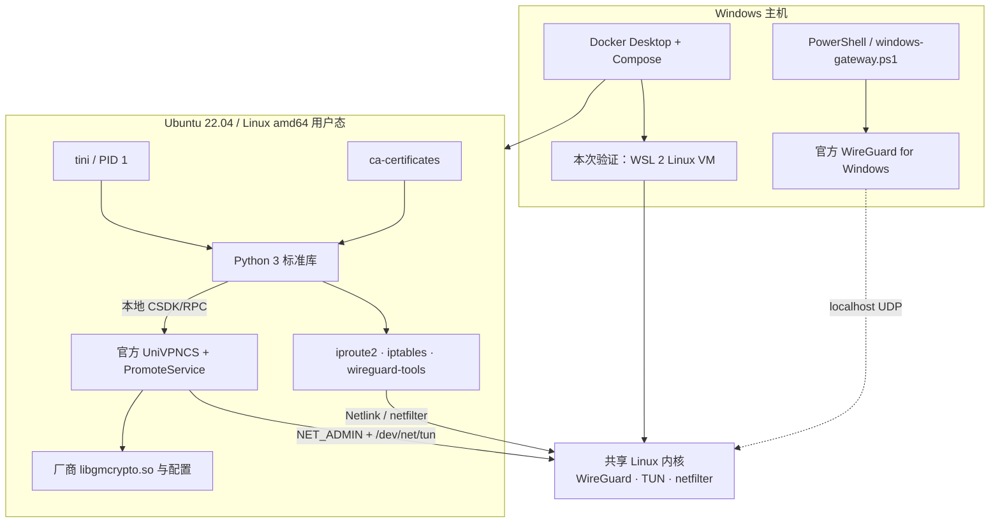

# 架构与依赖

本页描述当前 `native` 默认路径。早期菜单 CLI 与 GUI 实验保留在研究文档，不属于默认镜像的运行依赖。

## 一套 VPN 对应一个网络命名空间

WireGuard 只负责主机到容器的三层入口，远端仍使用 UniVPN。`wg0` 是 Linux 内核接口，不是第二个常驻代理程序；默认 Compose 中只有一个 `vpn` 服务。

每套 VPN 都有独立的接口、认证状态、目标范围与路由。多个实例不共享彼此的 namespace，不使用 host 网络。Windows 端仍按目的地址选路，因此重叠的远端 CIDR 不能仅靠容器隔离同时区分。

## 控制面不转发业务包

`native_control.py` 提供 root-only Unix IPC，`native_rpc.py` 处理分帧和总超时，`native_messages.py` 构造固定版本消息，`challenge.py` 约束会话和单次提交，`native_auth.py` 区分认证、隧道与数据面。`native_service.py` 监管进程和守卫；`gateway.py` 只管理本项目命名链。

Python 不处于逐包数据路径中。后台统一主动探测，状态请求读缓存，避免“探针锁忙”被误判为 VPN 失效。会话失败、过期或取消后需要重新启动引擎并显式认证，不自动重发短信。

## 运行依赖分层

这里列的是直接运行依赖，不展开 apt 的全部传递共享库。具体安装、复制范围以 [Dockerfile](../Dockerfile) 为准。

| 层级 | 组件 | 职责 |
| --- | --- | --- |
| 主机 | Docker Desktop / Compose | 构建与启动 Linux 容器、发布 localhost UDP |
| 主机 | WireGuard for Windows | 专属虚拟网卡与精确目标路由；管理界面不必持续打开 |
| 主机 | PowerShell 辅助脚本 | 只读计划、配置校验、专属服务安装/移除与选路检查 |
| 内核 | WSL 2 Linux kernel | 容器共享的网络栈、WireGuard、TUN 与 netfilter |
| 权限 | NET_ADMIN、TUN 设备、IPv4 forwarding | 仅在本实例 namespace 配置网络；不是新增软件服务 |
| 镜像 | Ubuntu 22.04 / amd64 | 当前官方程序与共享库的已验证用户态环境 |
| 镜像 | Python 3 标准库 | CLI、IPC、MFA 状态机、证书预检、后台探针；无第三方 Python 包 |
| 镜像 | UniVPNCS / PromoteService / 厂商库 | 官方认证和远端隧道；版本与摘要固定，由用户自备安装包 |
| 镜像 | iproute2 / iptables / wireguard-tools | 接口、路由、受限转发与 WireGuard 配置 |
| 镜像 | tini / ca-certificates | PID 1 子进程回收、默认 CA 信任基础 |
| 外部 | 远端 UniVPN 网关、账号与 MFA | 用户已获授权的环境，不由本项目提供或替代 |

Git 是获取源码的工具；Node.js、Astro 与博客配图工具仅用于文档站构建，不是 VPN 运行依赖。Windows 无需为默认入口另装 Python。默认 native 镜像不安装 Qt、X11、Xvfb、DBus、AT-SPI 或 VNC。

## 数据范围、就绪和回落

`vpn.json.allowed_cidrs`、Windows peer AllowedIPs 决定目标；容器 peer 只接受 Windows 的单个接入 `/32`。过滤还要求指定 VPN 出口，SNAT 让远端回复返回同一容器。

认证成功、隧道启动、真实探针通过是三件事。探针失败后，下一次守卫更新将专属链改为 DROP；即使普通 `eth0` 存在可用路由，也不允许作为 WireGuard 的替代出口。状态缓存会带来轮询与探针超时延迟。

Windows 选择相同前缀时比较 route metric 和 interface metric。本轮旧 VPN 也有相同 `/32`，因此需把新接口设为 ActiveStore metric=0 并用 `Find-NetRoute` 复核；不能仅靠 SSH 能连上判断新入口有效。规则与隔离实验、真实 Windows 验证分别见[实测记录](subnet-gateway-validation.md)。

## 配置和生命周期

| 文件/状态 | 归属 | 约束 |
| --- | --- | --- |
| `.env` | 本机 Compose 设置 | 安装包摘要、配置目录、UDP 端口，不放 VPN 密码 |
| `vpn.json` | 单个 VPN 实例 | 网关、允许目标、客户端地址、真实业务探针 |
| `wg0.conf` | 容器接入端 | 私钥、Windows 公钥和接入地址，运行时复制为 0600 |
| `univpn-*.conf` | Windows 接入端 | 私钥、容器公钥和业务 CIDR，仅受限本地文件 |
| 登录上下文、日志目录 | 容器 tmpfs | 不复用过期挑战；不通过 Docker 日志发布厂商回显 |

首次启动前备齐配置，可自动拉起 wg0；已认证后才加接入配置可以热加载接口，避免重置短信会话。运行中的目标 allowlist 不自动随 JSON 刷新。更新镜像则需要重建容器和显式认证。

## 已验证范围与后续设计

当前有真实 Windows 默认连接的四个 `/32`、HTTP 双向 1 MiB、UDP 和探针失败/恢复证据。协议兼容只验证 **10781.21.0.0831 / Linux amd64**，本地 CSDK/RPC 不是本项目能保证稳定的公共厂商 API。

真实厂商断线与重新认证、Docker/WSL 重启、Windows 接口优先级持久性、条件 DNS、IPv6 和重叠目标映射仍需分别验收。源码中的健康查询竞争修复与当前存量容器部署状态也要分开记录。

简化时优先减少重复输入与用户命令，不移除已验证的隔离或 MFA。具体取舍见[简化分析](simplification.md)。早期方案保留在[历史设计稿](design.md)。

参考：[Docker Desktop 网络](https://docs.docker.com/desktop/features/networking/)、[WireGuard 快速开始](https://www.wireguard.com/quickstart/)、[Windows 服务接口](https://git.zx2c4.com/wireguard-windows/about/docs/enterprise.md)。
