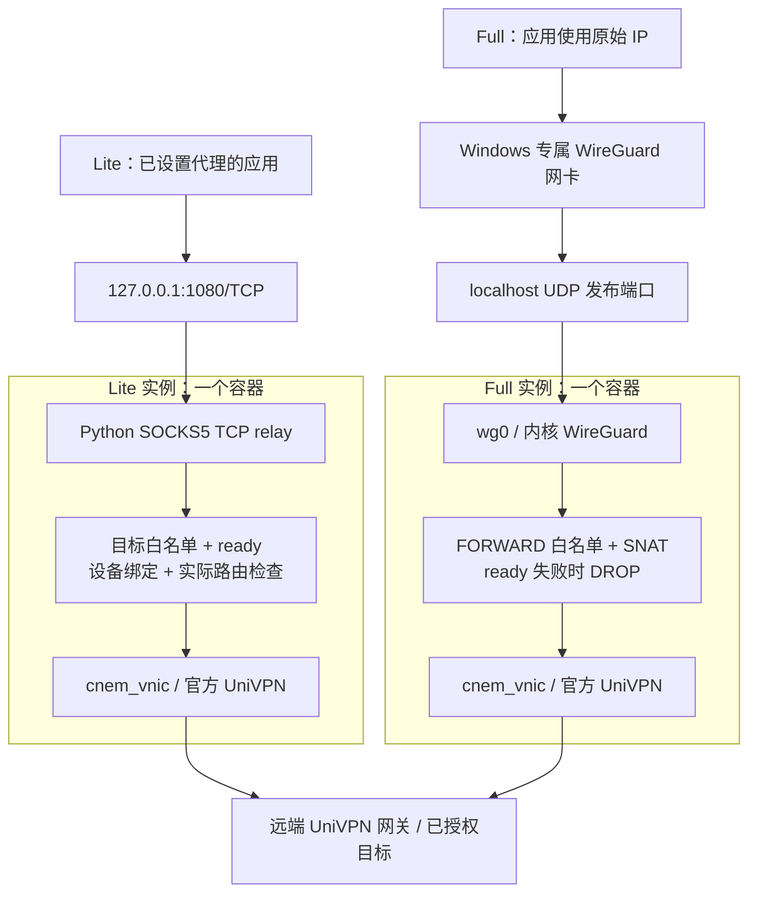
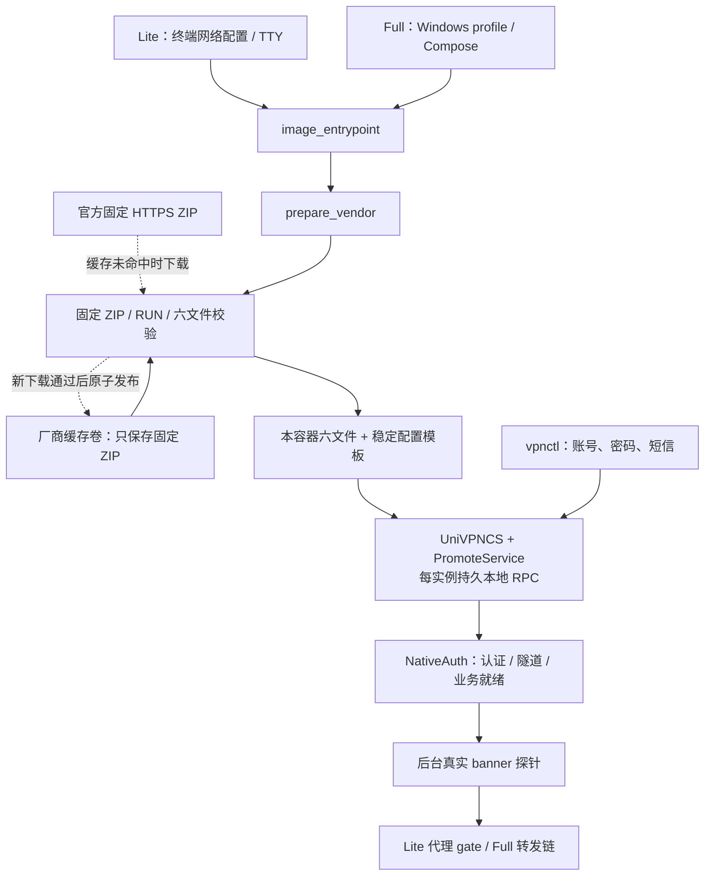
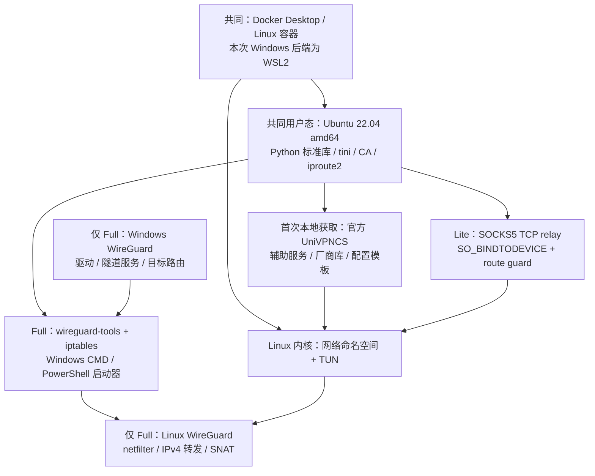

# Lite / Full 架构与依赖

0.4.0 提供两种入口，共用官方 UniVPN 的原生认证实现，**每个实例仍有独立的引擎、会话、网卡和路由**。公开镜像不含厂商安装包或二进制，首次在用户机器上从官方获取并校验。

| | Lite | Full |
| --- | --- | --- |
| 标签 | `lite` / `0.4.0-lite` | `full` / `0.4.0-full`；兼容别名 `latest` / `0.4.0` |
| Windows 应用入口 | 应用配置 `127.0.0.1:1080` SOCKS5 | 应用直接使用目标原始 IP |
| 范围 | SOCKS5 CONNECT，数字 IPv4、TCP | 明确的 IPv4 目标 CIDR，TCP / UDP |
| Windows 网络组件 | 不需要 WireGuard，不修改网卡或路由 | 启动器准备官方 WireGuard 和专属 `univpn-*` 接口 |
| 使用方式 | 容器终端配置、登录并保持前台运行 | 导出客户端，Windows 启动器连接和管理实例 |

Lite 是应用代理，不是透明网段入口；裸 `ssh` 不会自动使用它。教程分别见 [Lite](lite.md) 与 [Full](quickstart.md)。

## 两条数据路径

**Lite 的业务字节经过 Python 流转发。** 每次连接只接受 `allowed_cidrs` 中的数字 IPv4：ATYP1 或域名字段中的规范点分 IPv4，真正域名、IPv6、BIND 和 UDP ASSOCIATE 均拒绝。它不解析代理请求中的目标域名；VPN 网关本身仍可配置为域名。

每个出站 socket 在 connect 前用 `SO_BINDTODEVICE` 绑定 `vpn_interface`，并以 `ip -j route get` 确认实际出口相同，任一步失败都不创建普通出口连接。代理只接受缓存状态中的布尔就绪值；缓存变为未就绪后拒绝新请求，按约 0.2 秒周期关闭已有流。并发、总握手时间与双向缓冲有上限。代理自身不提供用户名密码认证，因此只将端口发布到本机回环地址，不将 VPN 账号填入应用的 SOCKS 认证栏。

**Full 的三层业务由内核转发。** `wg0` 和 `cnem_vnic` 位于同一容器；Python 控制认证、业务探针及专属链，不代理每个业务字节。只允许已配置源地址和目标从 VPN 接口转发，SNAT 提供返回路径；普通 `eth0` 不作为替代出口。应用自己指定的代理仍生效，Full 不会取消它。

两版均不使用 host 网络或共享实例网络命名空间。Full 的重叠目标会竞争同一 Windows 路由表；Lite 由应用选择不同代理端口，但多实例重叠目标仍未独立验收。两版都不提供内网条件 DNS 或 IPv6。

## 共用的准备与认证控制

[vendor_runtime.py](../univpn_gateway/vendor_runtime.py) 只解出固定 `10781.21.0.0831` 所需的六个文件及稳定 `sysconfig.ini` 副本，不执行厂商安装脚本。缓存有互斥和原子发布，已安装文件或缓存每次复核；损坏或摘要变化会失败，不换未校验来源。缓存可复用，**可变配置和认证会话不共享**。默认 Full Compose 项目各有缓存卷；Lite 示例明确命名的卷可供不同实例复用固定归档。

两版通过同一 [native_service.py](../univpn_gateway/native_service.py)、[native_auth.py](../univpn_gateway/native_auth.py) 控制官方引擎。密码与短信由 `vpnctl` 的 TTY 输入，验证码续交到同一挑战；失败、过期或取消后不自动重试。认证成功、隧道启动、真实目标探针通过是三个状态，监听端口存在不表示已放行业务。状态查询只读最近结果，不额外发起探针；状态和门控有轮询及探针超时延迟。

## 依赖分层

共同基础层还安装 `iptables`，但 Lite 的 SOCKS 路径不依赖 Full 的 FORWARD/SNAT 链。Lite 镜像没有 `wireguard-tools`、Windows 客户端文件或 WireGuard 内核接口要求；Full 才额外使用这些组件。两版均使用 `NET_ADMIN` 和 `/dev/net/tun`，不需要 privileged；无第三方 Python 包或 Qt/X11/VNC 图形栈。

Full 的 Windows 启动器导出五个文件，`Init` 生成受限 profile、双端 WG 密钥及 Plan；`Connect` 串接容器准备、TTY 登录或 SMS 续交、专属 tunnel 安装/复用及一个普通 TCP banner 检查。WireGuard 已有效安装则复用，完全缺失才验证官方固定 MSI 并请求安装；不修复/升级部分或异常安装。MSI 和创建隧道可能分别要求 UAC，3010 会停止并提示重启。Linux 容器不会替 Windows 安装驱动。

## 状态与生命周期

| | Lite | Full |
| --- | --- | --- |
| 网络配置 | `/config/lite/vpn.json`，root 0700 目录 / 0600 文件；已有配置只读复用 | Windows `private/<name>/` 的 profile、网络配置、WG 密钥及 Compose |
| 认证与运行 | `docker run -it` 的同一终端配置和登录，保持前台；高级 `serve` 可配合独立 TTY 登录 | 容器服务与 Windows launcher 分离；有效短信挑战续交，已认证时不重复密码 |
| 就绪失败 | 拒绝新 SOCKS 请求并关闭已有流；不影响 Windows 路由 | 专属转发链 DROP；Windows 接口仍可能为 Up |
| 停止 | 示例 `Ctrl+C` 结束容器；`--rm` 删除可写层，配置和厂商缓存卷保留 | `Stop` 停容器，保留 Windows 网卡、路由、密钥与缓存 |
| 移除入口 | 停容器后本机代理端口释放；应用仍保留其代理设置，需用户自行调整 | `Remove` 卸载本实例 tunnel，再 Compose down；保留 profile 文件与缓存卷 |

自有前端不把账号、密码或 OTP 写入网络配置或厂商缓存。厂商运行文件、日志和进程内认证状态属于本次实例，不能把正在运行的容器 commit 成公开镜像。重建容器需要显式重新认证，卷保留不等于保留登录会话。停止某个实例也不会自动关闭 Docker Desktop/WSL 平台。

## 验证边界

- **既有 Full 真实链路：** 原生短信认证；Windows 默认选路 4/4 SSH、双向各 1 MiB HTTP、UDP、探针故障阻断与恢复。[证据](subnet-gateway-validation.md)
- **Lite 协议与隔离网络：** [单元测试](../tests/test_socks_proxy.py) 覆盖握手、半关闭、部分写入及就绪撤销；[独立 namespace 测试](../tests/socks_integration.py) 已在一次性 Docker 容器通过真实内核设备绑定、SSH、1 MiB HTTP、来源、白名单、就绪恢复，以及普通出口可用时的回落阻断。VPN 一侧是 veth 模拟，不能代替真实 UniVPN 数据面。
- **Lite 镜像准备：** 已验证缓存校验、TTY 配置向导、官方引擎 idle 及未认证 SOCKS 请求拒绝；这不是一次真实登录。
- **仍待验收：** 新 Lite 入口真实 VPN 登录后的整体路径、新 Full launcher 的完整短信/新网卡流程、Windows 服务/系统重启的优先级持久性及真实厂商断线重认证。现存已连接旧容器没有重建，健康查询竞争修复尚未在该会话生效。

构建、固定摘要和许可见[镜像说明](image-release.md)，取舍见[简化分析](simplification.md)。
