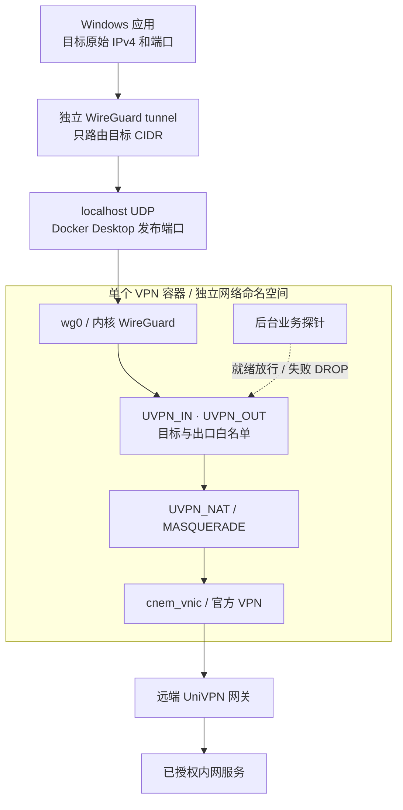
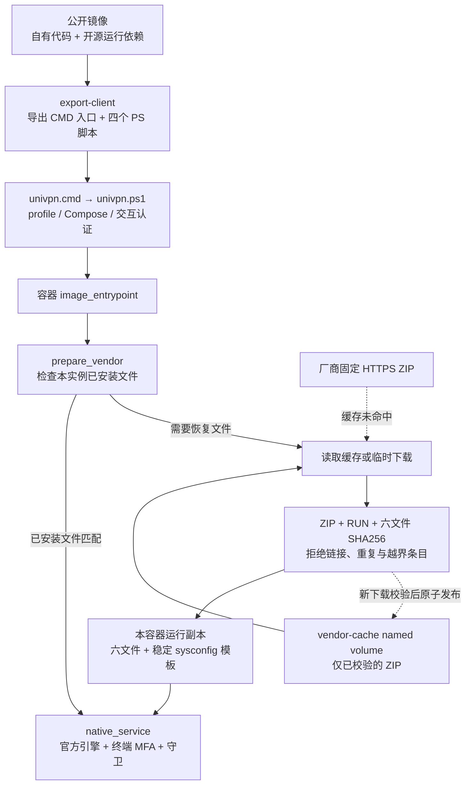
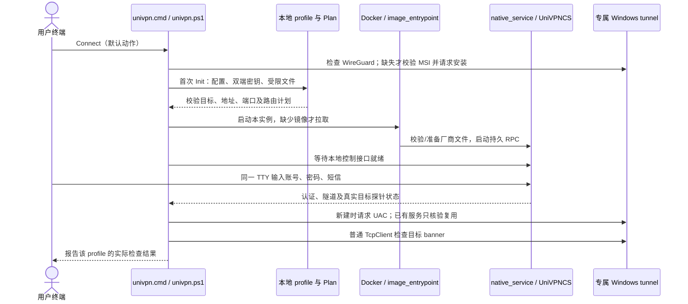
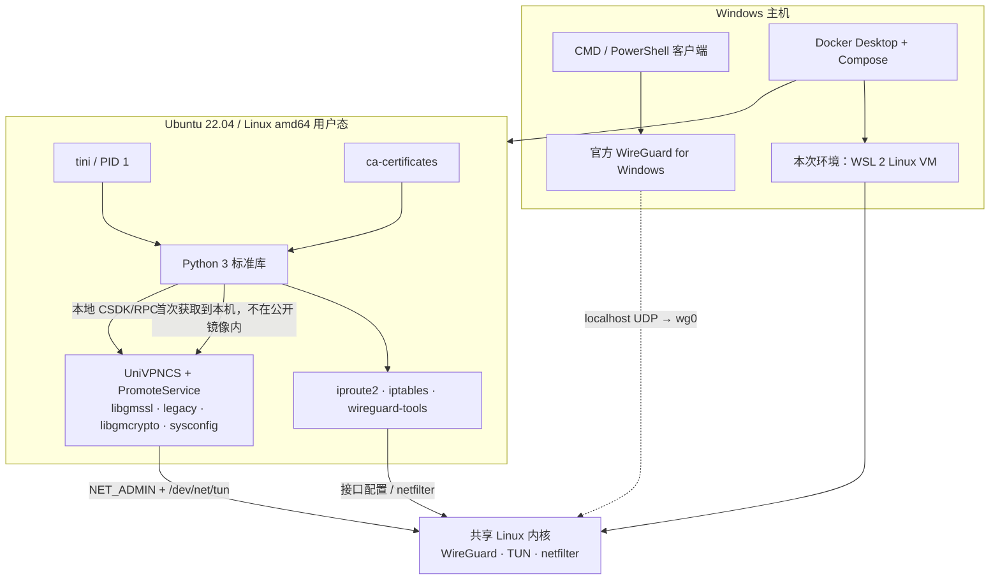

# 架构与依赖

本页描述 0.3.0 的公开镜像与 Windows 客户端入口。默认镜像为 `javazero/univpn-docker-gateway:latest`，版本标签为 `0.3.0`；它包含自有前端、脚本及运行依赖，**不包含官方 UniVPN 安装包或二进制**。厂商组件在用户机器上首次启动时从官方获取。发布与离线边界见[镜像说明](image-release.md)。

## 一套 VPN 对应一个网络命名空间

WireGuard 提供 Windows 到容器的三层入口，远端连接仍由 UniVPN 完成。`wg0` 是 Linux 内核接口，不是第二个常驻代理程序；每套 VPN 只运行一个容器，不按 SSH、HTTP 等业务逐个发布端口。

实例之间不共享网络命名空间，不使用 host 网络。Windows 仍按目的 IP 选路，因此容器隔离不能同时区分两套 VPN 中相同的远端地址；当前不提供重叠目的地映射、IPv6 或条件 DNS。

## 镜像交付与厂商组件准备

公开构建使用 [Dockerfile.public](../Dockerfile.public)，不运行厂商安装器。首次准备从固定 ZIP 中只读取白名单文件，写入当前容器的 `/usr/local/UniVPN`、`/lib/libgmcrypto.so` 和 `/opt/gateway/vendor-sysconfig.ini`，去掉归档中的 setuid 位；不执行安装脚本或它的系统配置修改。

缓存只保存验证过的 ZIP，带互斥和原子发布；每个容器复制出自己的厂商文件，不把会被引擎修改的配置目录放入共享缓存。默认 Compose 项目各有自己的 named volume；重建同一项目可复用缓存，不等于所有实例共享一次下载。缓存损坏或摘要变化会失败，不回退到第三方或未校验包。

`export-client` 导出 `univpn.cmd`、`univpn.ps1`、`windows-profile.ps1`、`windows-gateway.ps1`、`windows-prerequisites.ps1` 到新的 `/output/univpn` 目录；不下载厂商程序，不启动 VPN，也不需要网络管理权限。导出拒绝合并覆盖旧目录。CMD 入口只调用同目录的 PowerShell 实现，执行策略例外限于该进程。

## Windows 宿主机引导

`univpn.cmd` 是镜像导出的 Windows 启动脚本，在用户选定空文件夹的 PowerShell 中运行。`windows-prerequisites.ps1` 由 Init/Connect 调用：标准目录下两个官方程序签名有效则复用，完全未安装时才获取固定 MSI、校验 SHA256 和 WireGuard LLC 签名后安装。部分安装、自定义位置或已有异常服务会先停止，不升级/修复既有客户端。

安装目标是 Windows 的 `C:\Program Files\WireGuard`，不在 Docker VM 中。MSI 使用 `/qn /norestart DO_NOT_LAUNCH=1`，不自动重启或打开 GUI；返回 3010 时先告知需要重启，停止后续连接。安装程序与后续专属 tunnel 创建可能分别需要 UAC。宿主机准备与 Linux 容器准备是两个步骤，Docker 镜像本身不会跨越这条权限边界。

只新增 `univpn-*` 隧道，已有 WireGuard 安装不运行 MSI；目标 CIDR 重叠时仍有实际选路竞争。关于三种接入方式，见[简化分析](simplification.md)。

## Windows 的连续入口

[windows-profile.ps1](../scripts/windows-profile.ps1) 的 `Init` 已实现双端密钥生成、访问地址和 `AllowedIPs` 配对、文件权限限制及只读 `Plan`；不再要求用户手工交换公钥或重复填写目标 CIDR。它不启动 Docker、不安装网卡，这些由 [univpn.ps1](../scripts/univpn.ps1) 的 `Connect` 串接。

`Connect` 对 idle 会话显式调用 `vpnctl login`，对尚未完成的短信挑战调用 `vpnctl sms`，已认证时不重新发送密码。失败、过期或取消的上下文需要用户先停止再明确发起新连接；没有自动重试认证或重发短信。口令和验证码只进入交互终端及受限本地 IPC，不进入 profile、命令参数或镜像。

新的 Windows tunnel 由已有校验器安装：只接受独立命名的接口，设置本次新接口的 IPv4 ActiveStore metric=0，再核对目标最佳路由。已有服务须为 Running 且目标路由正确才能继续复用；不自动覆盖服务或修改其他 VPN 的优先级。最终检查是**一个配置目标的普通 TCP banner**，不会自动替用户验证所有目标的 HTTP/UDP。

## 运行依赖分层

| 位置 | 需要的组件 | 职责 |
| --- | --- | --- |
| Windows | Docker Desktop / Compose、PowerShell、官方 WireGuard | 启动容器、导出/运行客户端、提供按目标选路的网卡；默认用户路径无需 Git、Node.js 或 Windows Python |
| Linux 内核 | WireGuard、TUN、网络命名空间、netfilter | 提供接口、路由、过滤与 SNAT；安装工具包不等于内核已有 WireGuard 支持 |
| 公开镜像 | Ubuntu 22.04 amd64、Python 标准库、tini、CA、网络工具与自有脚本 | 准备厂商组件、控制认证、管理进程和转发；没有第三方 Python 包或图形栈 |
| 首次本地获取 | 固定 `10781.21.0.0831` 的六个厂商文件及稳定配置模板 | 实际协议兼容、远端认证与 UniVPN 隧道；其许可独立于本项目 GPL |
| 权限 | `NET_ADMIN`、`/dev/net/tun`、IPv4 forwarding | 只配置本实例网络；不用 privileged，也不接管宿主机网络命名空间 |
| 外部 | 官方下载服务、远端 VPN 网关、合法账号和 MFA | 首次缓存未命中需访问下载服务；每次真实连接仍需远端认证及业务环境 |

WSL2 是本次部署后端，并非 Docker Desktop 唯一可能的后端。当前兼容验证限于 Linux amd64 与上述厂商版本。默认路径没有 Qt、X11、Xvfb、DBus、AT-SPI 或 VNC；历史 CLI/GUI 目标只作研究对照。

## 状态、配置和生命周期

| 状态或文件 | 生命周期 |
| --- | --- |
| 导出的五个客户端文件 | 跟随镜像版本；再次导出用新目录，不覆盖已有客户端 |
| `private/<name>/profile.json`、`vpn.json`、双端 WG 配置 | 本机 profile；密钥不覆盖，目标从单份配置配对；运行中修改 JSON 不自动刷新白名单 |
| profile 内生成的 `compose.yml` | 固定该实例的镜像、端口、项目与挂载；已有 profile 不会因重复 Connect 自动升级镜像 |
| `vendor-cache` named volume | 只缓存固定 ZIP；停止或普通 `compose down` 不删除卷 |
| 本容器厂商运行副本及稳定模板 | 从校验包恢复；不共享可变配置，稳定模板支持官方删除原配置后的初始化 |
| 登录上下文及厂商日志目录 | 运行期状态；过期挑战不复用，厂商子进程输出不直接转入 Docker 日志 |

认证成功、隧道启动、业务就绪分别判断。后台统一主动探测接口、目标路由及真实 banner，状态请求只读最近结果；失败后守卫更新专属链为 DROP，即使普通 `eth0` 有可用路由也不准回落。状态与门控存在轮询和探针超时延迟。

`Stop` 只停止本实例容器，保留 Windows 接口、目标路由、密钥和缓存；这时目标可能仍指向不可用入口，Docker Desktop/WSL 也不会自动退出。`Remove` 卸载本实例 Windows tunnel 后执行本项目 `compose down`，保留本地 profile 和 volume；不删除其他 VPN。

## 已验证与尚待验收

既有链路已通过真实短信认证，以及 Windows 默认选路的 4/4 SSH、双向各 1 MiB HTTP、UDP 和探针故障阻断/恢复，详见[网段网关记录](subnet-gateway-validation.md)。这不代表新 `Connect` 包装器已经完成一次真实短信与新 Windows 安装的全流程验收。

新准备流程已完成全新缓存的官方在线下载，以及第二个无网络新容器的 `cache_hit: true` 检查。公开 push 及新包装器验收应以各自发布记录为准。现存已连接旧容器尚未重启，健康查询竞争修复仍未在该会话生效。Windows 服务/系统重启的优先级持久性、真实厂商断线后的重新认证、Docker/WSL 重启恢复仍需独立验证。

参考：[Docker Desktop 网络](https://docs.docker.com/desktop/features/networking/)、[WireGuard 命名空间](https://www.wireguard.com/netns/)、[Windows 隧道服务](https://git.zx2c4.com/wireguard-windows/about/docs/enterprise.md)。进一步取舍见[简化分析](simplification.md)，使用方式见[快速开始](quickstart.md)。
